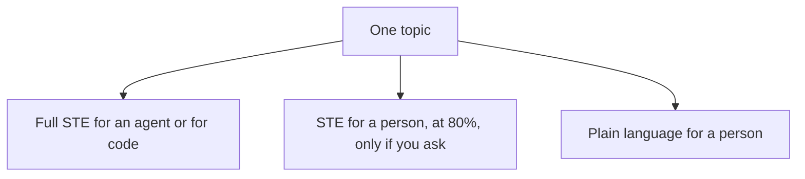
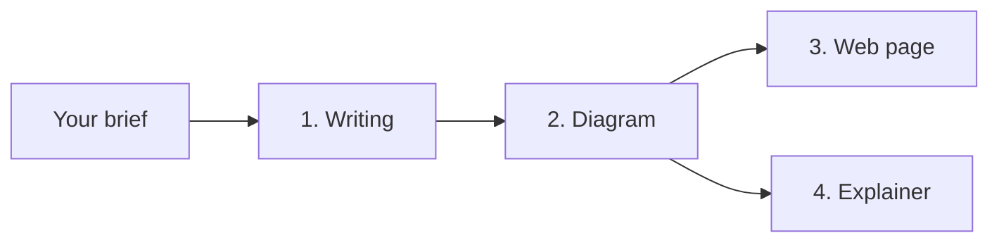
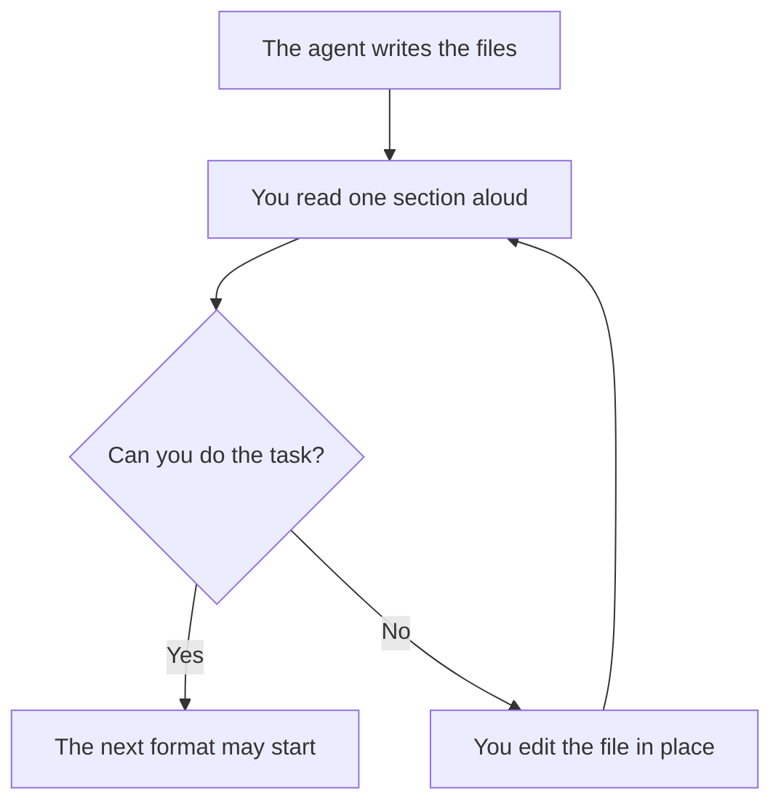

# Doc clarity

You put one topic in. You get writing you can check. After that, you can ask for a diagram, a web page, or a short explainer video.

The writing comes in separate files, so a person and an agent never share one mixed document.

| You ask for | You get | The rule it follows |
|---|---|---|
| Text for an agent or for code | `machine/text.md` | ASD-STE100, in full |
| STE a person can read | `ste-human/text.md` | ASD-STE100 at 80%, and only when you ask |
| Text for a person | `human/text.md` | ISO 24495-1 plain language |

The 80% target belongs to the STE file for a person. It does not apply to the plain-language file.

## How a run climbs

Writing comes first. You can stop after any step you accept. The web page is optional when you want a video. A video does not read the web page. Both of them read the writing, and a diagram when you made one.

Each box is a folder under `stages/`. The folder's `CONTEXT.md` says what goes in, what comes out, and how you check it.

## Start a run

1. Copy `_templates/brief.md` to `inbox/brief.md`.
2. Fill in one topic. Name who will read the plain-language text, and what they must be able to do after one read.
3. Leave `ste-human` as `no` unless you want the 80% STE file. Leave `climb-to` as `writing` unless you already want a later format.
4. Ask an agent to run stage 01, then stop.

The defaults live in `_shared/defaults.md`. A normal run writes the full STE file and the plain-language file, and stops after writing.

## You are the check

The agent drafts. You decide the meaning is right before the next format starts.

For the STE files, a script also runs first. `python _tools/ste_check.py` writes `check.md` next to the file. A first line of `fail:` means the agent fixes the text and runs the script again. The script does not run on the plain-language file. You write that `check.md` yourself.

When you accept a file, `check.md` starts with `pass` and includes the line `human: pass`.

## Where to look

| You want | Open |
|---|---|
| The stage order | [CONTEXT.md](CONTEXT.md) |
| Why these four formats | [_shared/ladder.md](_shared/ladder.md) |
| The standards behind the rules | [_shared/sources.md](_shared/sources.md) |
| The same map, written for an agent | [agents/README.md](agents/README.md) |

## License

This repository is [MIT](LICENSE), copyright 2026 David Vogel.

Two limits sit outside that grant:

- ASD-STE100 and ISO 24495-1 stay with their owners. The files here are working summaries. Certify a document only against the official issue. Details are in [_shared/sources.md](_shared/sources.md).
- `_tools/links.py` comes from the ICM architect project, copyright 2026 Jake Van Clief, MIT. `_tools/ste_check.py` and the plain-language and checker word lists come from the ICM clarity stage, MIT.
