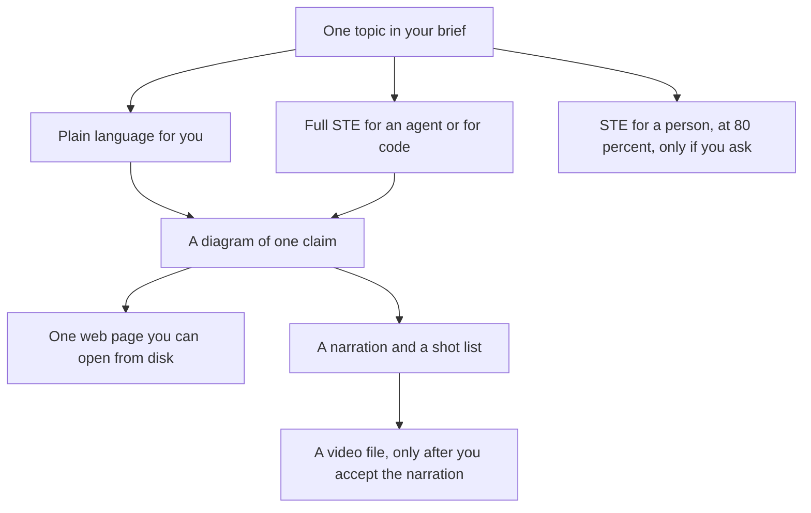
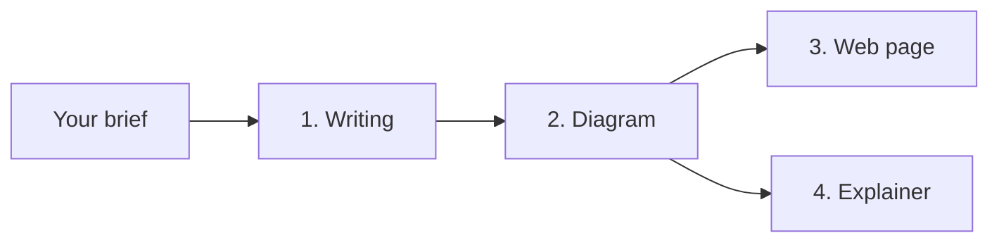
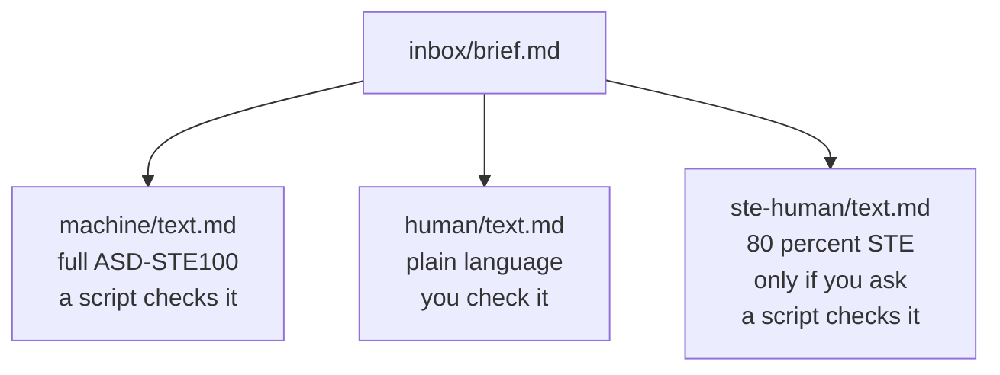
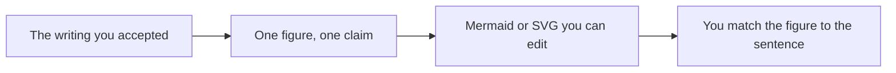
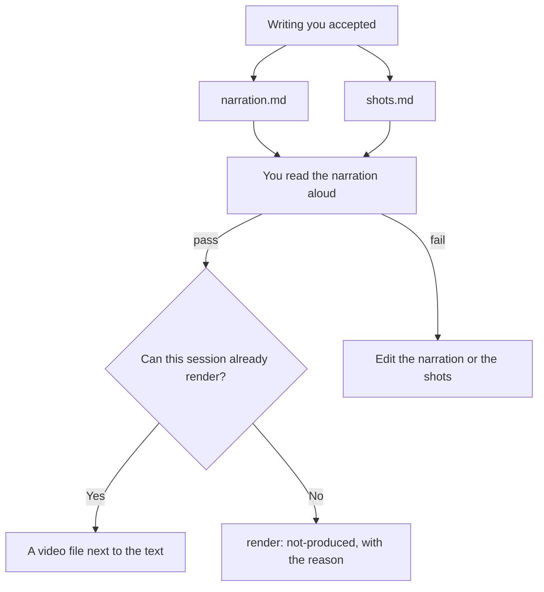
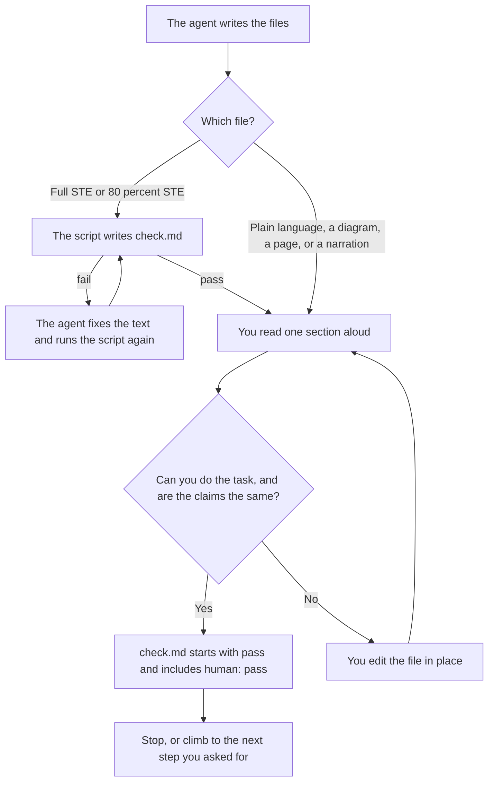
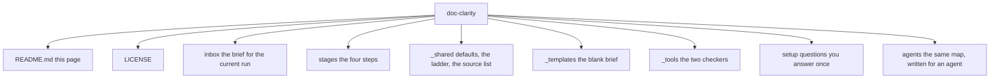

# Doc clarity

You give this project one topic. It gives that topic back in forms you can check: writing first, then a diagram, a web page, and a short explainer when you want them.

A person and an agent do not share one mixed document. Each reader gets a file written for that reader. You read a section aloud, and you decide when the meaning is right. The agent drafts. You keep the meaning.

This page is the whole guide. You can run a topic from what is written here.

## What you get from one topic



You can stop after writing. You can stop after a diagram. The web page is optional when you want a video. The video does not read the web page. Both of them repeat the writing you already accepted. They do not add new facts.

## Why the work is in this order

Andrej Karpathy wrote on 2 October 2026 that we will spend more time trying to understand what language models produce. He named four ways to make that output easier to take in, each one able to replace a wall of text:

1. Ask for [ASD-STE100](https://www.asd-ste100.org/), a controlled language from aerospace manuals. Short sentences. One idea each. Active voice. A small vocabulary. When full STE sounds too stiff for a person, ask for about 80 percent of the way there.
2. Ask for a diagram. A figure can be easier to process than the paragraph it replaces.
3. Ask for the output in HTML. You get one page, and interaction only where it helps you do the task.
4. Ask for a custom explainer video. He is most confident about this one. The example he gave is a 3b1b-style explainer, with narration from a voice tool you already have, or from a free tool on your own computer.

His post is [here](https://x.com/karpathy/status/2105819303471976479).

This project runs those four steps in order. A wrong sentence is cheap to fix in writing. The same wrong sentence is expensive after it is drawn, built into a page, or spoken in a video. Later steps repeat the claims you already checked.



You name the last step in the brief with `climb-to`. The choices are `writing`, `diagrams`, `web`, and `video`. Writing always happens. You may skip the web page when you want a video and not a page.

## 1. Writing

The stage folder is `stages/01_doc-clarity/`.

The agent rewrites your brief. It may change the wording. It may not change the claims, drop a condition, or add a fact that your brief does not contain. Code blocks, configuration, and data pass through untouched.

You get up to three files. They live under `stages/01_doc-clarity/output/{slug}/`. `{slug}` is the short name you put in the brief, in lowercase with hyphens.

| File | Who it is for | Which rules | When it is written |
|---|---|---|---|
| `machine/text.md` | An agent, or code that must act on the text | ASD-STE100, in full | When `audiences` is `machine` or `both` |
| `human/text.md` | A person who must do something after one read | ISO 24495-1 plain language | When `audiences` is `human` or `both` |
| `ste-human/text.md` | A person who asked for STE that still sounds like a person | ASD-STE100 at 80 percent | Only when you set `ste-human: 80` |

A normal run writes the first two files and skips the third.



### Full STE, for an agent or for code

ASD-STE100 is Simplified Technical English, Issue 9, 15 January 2025. ASD owns the standard. You can request the official PDF from [asd-ste100.org](https://www.asd-ste100.org/). The files in this repo are a working summary. They are not the official dictionary. Certify a document only against the official issue.

The summary an agent follows is [stages/01_doc-clarity/references/ste-issue-9.md](stages/01_doc-clarity/references/ste-issue-9.md). In plain words, full STE means:

- Use an approved word with its approved meaning and its approved part of speech.
- Use a technical name only when your brief already gives that name. The agent does not invent one.
- Keep sentences short. A procedure sentence stays at about 20 words. A note stays at about 25.
- Put one idea in a sentence, and one instruction in a procedure sentence.
- Put the condition first, then the command.
- Use active voice. Use the imperative for an instruction.
- Do not use a contraction. Do not leave out a word to save space.
- Prefer a vertical list when a sentence would become a long series.
- Use American spelling unless an official directive says otherwise.
- A warning, a caution, or a note comes before the step it protects. A note gives information. A note does not give an instruction.

A script enforces the word list and the sentence length. The list is [stages/01_doc-clarity/references/ste-rules.md](stages/01_doc-clarity/references/ste-rules.md). From the project root:

```bash
python _tools/ste_check.py stages/01_doc-clarity/output/{slug}/machine/text.md --audience machine
```

The script writes `machine/check.md`. The first line is `pass`, or `fail:` plus the reason. A failure stops the run. The agent fixes the text and runs the script again.

### Plain language, for a person

ISO 24495-1:2023 is the plain-language standard. The record is [ISO 24495-1:2023](https://www.iso.org/standard/78907.html). The working summary is [stages/01_doc-clarity/references/plain-language.md](stages/01_doc-clarity/references/plain-language.md).

Plain language means you can find what you need, understand it, and use it, with an effort you would consider reasonable. Four principles do that work:

- **Relevant.** The text has what you need for the task, and it does not bury that under extra detail.
- **Findable.** The important part comes first. Headings match the task. You do not have to hunt.
- **Understandable.** The words are ones you already know. A new term is explained at first use. Sentences are short enough to hold in mind.
- **Usable.** After one read, you can do the thing.

This file may say "you". Contractions are fine. Warmth is fine. The 80 percent STE target does not apply here. The STE script does not run on this file. You are the check.

### STE at 80 percent, only when you ask

Karpathy's softening lives in its own file, `ste-human/text.md`. It is still ASD-STE100. It is not the plain-language file.

About four sentences in five keep the STE shape: one idea, active voice, the approved word, a short sentence, one instruction in a procedure, the condition before the command. The rest is tone. The file may say "you". It may use a contraction. It may keep a common word when the approved word is hard to say aloud. That word is recorded in the file's front matter under `clarity-exceptions`. A dropped condition still fails.

The script for this file uses the 25-word limit:

```bash
python _tools/ste_check.py stages/01_doc-clarity/output/{slug}/ste-human/text.md --audience human
```

Set `ste-human: no` in the brief when you do not want this file. That is the default.

### One meaning, three wordings

When more than one writing file exists, they make the same claims, in the same order of conditions. The plain-language file may sound warmer. The 80 percent file may sound more like speech. Neither file may know something the full STE file does not.

The agent also writes two small index files:

- `stages/01_doc-clarity/output/current.md` names the active slug.
- `stages/01_doc-clarity/output/{slug}/manifest.md` lists which of the three text files exist.

Later steps read `current.md` first, then the manifest. A value of `none` means that file was not written.

## 2. Diagrams

The stage folder is `stages/02_diagrams/`.

A diagram replaces a paragraph when a relationship, a sequence, a comparison, or a layout is easier to see than to read. One figure carries one claim, and that claim is a sentence already in the writing. Labels use the nouns from that writing. The agent does not invent a synonym, and it does not draw a fact the writing does not state.

You can correct the figure without generating a new image. Each figure has an editable source, Mermaid (`.mmd`) or SVG (`.svg`). A PNG is optional, and it must match that source.

If no figure helps, the agent says so in one sentence and sets `figures: none`.

The words on the figure come from `human/text.md` when that file exists. They come from `ste-human/text.md` only when the plain-language file was not written. They come from the full STE file only when neither of those exists.

You compare each figure with its claim sentence. You write `stages/02_diagrams/output/{slug}/check.md`. The first line is `pass`, or `fail:` plus the reason. You edit the source in place.



## 3. A web page

The stage folder is `stages/03_web-pages/`.

You get one HTML file: `stages/03_web-pages/output/{slug}/page.html`. You open it from disk. There is no install, no network, and no build step. The CSS and the script are inside the file. It does not load a remote font, script, or image.

The page helps you do the purpose named in the writing. The important part comes first. A control, a slider, or a comparison appears only when the writing already describes that action. The page does not add a claim, a metric, or a section. When a diagram passed its check, the page draws that figure inside the file.

Headings are real headings. You can reach every control from the keyboard. Text and background contrast enough to read. This stage does not certify WCAG. It does keep those three habits so you can use the page.

You open the file and do the task. You write `check.md` beside it. The first line is `pass`, or `fail:` plus the reason. The video step does not read this page.

The page is for this topic and this run. It is meant to be useful, and it is fine to throw it away when the topic is done.

## 4. An explainer video

The stage folder is `stages/04_explainer-videos/`.

The spoken text and the shot list come first. A video file comes only after you accept that text, and only when the session can already render one.

You receive:

- `narration.md`, one sentence a line. The purpose is in the first two lines. The claims match the writing, in the same order. A sentence may be split. A new claim may not be added. Aim for one to three minutes. A longer topic becomes two runs.
- `shots.md`, a numbered list. Each item names the picture and the narration lines that play over it. One idea is on screen at a time. The picture changes with the sentence. A passed diagram is used when it carries that claim.
- `manifest.md`, which names those files and says whether a video was rendered.

"3b1b style" here means that visual buildup. It does not mean copying a creator's assets, brand colors, or footage.



You read the narration aloud against the writing. You write `check.md`. Render happens after the first line is `pass`. If a video file exists, you watch it once and confirm the picture matches the shot list. If it does not, you set the first line back to `fail:` and the reason.

The agent does not ask you for an API key. It does not store a key in this repo. If no render tool is already available, the text files are the result, and the manifest says `render: not-produced`.

## How you accept a file

Nothing moves to the next step until the last step's check passes. You may stop after any pass.



For every file you accept, `check.md` starts with `pass` and includes the line `human: pass`. On the STE files, the script creates `check.md` and you add that line after you have read the text. On the plain-language file, and on later steps, you create `check.md` yourself.

When more than one writing file exists, you also confirm they make the same claims.

A `.gitkeep` file only keeps an empty folder. It is not a finished step.

## Start a run

1. Copy `_templates/brief.md` to `inbox/brief.md`. One brief at a time. Leave the template itself unchanged.
2. Fill in the fields below.
3. Ask an agent to run stage 01, then stop for your check.

| Field | What you put there |
|---|---|
| `slug` | A short name for the folder, lowercase, hyphens. Example: `sync-key`. |
| `title` | The name a person sees on the page and in headings. |
| `audiences` | `machine`, `human`, or `both`. `both` is the usual choice. |
| `ste-human` | `no`, or `80` when you want the extra STE file for a person. |
| `climb-to` | `writing`, `diagrams`, `web`, or `video`. This is the last step. |
| `readers` | Who will read the plain-language text, and what they already know. |
| `purpose` | What they must be able to do after one read. |
| Source | The notes, the draft, or the question. This is the meaning. |
| Task | The same purpose, in a sentence. |
| Keep | Technical names to keep. Terms to avoid. |

The agent reads your brief first. If a field is empty, it uses `_shared/defaults.md`.

## What a normal run does

These defaults are already set. Your brief overrides any line you fill in.

| Setting | Default |
|---|---|
| Audiences | `both`, so you get full STE and plain language |
| 80 percent STE file | `no` |
| Last step | `writing` |
| Reader | A person who must do the task after one read |
| Diagrams | One claim in each figure |
| Web page | One self-contained HTML file, no brand colors |
| Video | Narration and shots first. Render only with a tool the session already has. No API key in the repo. |

To change the defaults for every future run, answer [setup/questionnaire.md](setup/questionnaire.md) once. The answers are written into `_shared/defaults.md`. Do not put an API key in that file.

## How you see progress

Look in `stages/*/output/`. A step is done when the artifact for this run is there and its `check.md` starts with `pass`.

`stages/01_doc-clarity/output/current.md` tells you which slug is active. Open that slug's folder to read the files.

## The whole repository



| Path | What it holds |
|---|---|
| [README.md](README.md) | This guide. |
| [LICENSE](LICENSE) | The MIT license. |
| [inbox/](inbox/CONTEXT.md) | The brief for the run that is in progress. |
| [_templates/brief.md](_templates/brief.md) | The blank brief you copy. |
| [_shared/defaults.md](_shared/defaults.md) | Defaults the brief can override. |
| [_shared/ladder.md](_shared/ladder.md) | Why the four steps exist, in shorter form. |
| [_shared/sources.md](_shared/sources.md) | The standards, the post, and the videos. |
| [setup/questionnaire.md](setup/questionnaire.md) | Questions that set the defaults once. |
| [stages/01_doc-clarity/](stages/01_doc-clarity/CONTEXT.md) | Writing. |
| [stages/02_diagrams/](stages/02_diagrams/CONTEXT.md) | Diagrams. |
| [stages/03_web-pages/](stages/03_web-pages/CONTEXT.md) | The web page. |
| [stages/04_explainer-videos/](stages/04_explainer-videos/CONTEXT.md) | The explainer. |
| [agents/README.md](agents/README.md) | The same pipeline, written as instructions for an agent. |
| `_tools/ste_check.py` | The STE sentence and word check. |
| `_tools/links.py` | The check that links and input paths still resolve. |

Each stage folder has a `CONTEXT.md` that names its inputs, its outputs, and its check, plus a `references/` folder with the rules for that step, plus an `output/` folder for the files a run produces.

The method underneath the folders is Interpretable Context Methodology. The folder order is the sequence. The `CONTEXT.md` files are the contracts. The files in `output/` are the state. You can see where a run is by opening those folders. You do not need a separate tracker.

## Where the rules come from

Two standards, and one public post, are the sources. The working copies in this repo are summaries.

- ASD-STE100 Simplified Technical English, Issue 9, 15 January 2025. [Official site](https://www.asd-ste100.org/). ASD owns the copyright and the trademark.
- ISO 24495-1:2023, Plain language, Part 1. [Official record](https://www.iso.org/standard/78907.html).
- Andrej Karpathy, 2 October 2026, [post 2105819303471976479](https://x.com/karpathy/status/2105819303471976479).

Two talks were named when this project was created. They discuss the standards. They are not a second copy of the rules:

- [ASD-STE100 for text that code and agents can read](https://www.youtube.com/shorts/g_pnwXpvzI8)
- [ASD-STE100 and ISO 24495 together](https://www.youtube.com/watch?v=xVTgczRj1YA)

These videos discuss Karpathy's post. They are not rule sources:

- [https://www.youtube.com/watch?v=h7nGYeafKpg](https://www.youtube.com/watch?v=h7nGYeafKpg)
- [https://www.youtube.com/watch?v=zjIiJoXmggk](https://www.youtube.com/watch?v=zjIiJoXmggk)
- [https://www.youtube.com/watch?v=w8GW65MquUQ](https://www.youtube.com/watch?v=w8GW65MquUQ)
- [https://www.youtube.com/watch?v=V4vD8Ho8D9w](https://www.youtube.com/watch?v=V4vD8Ho8D9w)

A related post linked at creation, also not a rule source: [https://x.com/hqmank/status/2106945748461928655](https://x.com/hqmank/status/2106945748461928655).

The same list, kept for agents, is [_shared/sources.md](_shared/sources.md).

## License

This repository is [MIT](LICENSE), copyright 2026 David Vogel.

Two limits sit outside that grant:

- ASD-STE100 and ISO 24495-1 stay with their owners. The files here are working summaries. Certify a document only against the official issue.
- `_tools/links.py` comes from the ICM architect project, copyright 2026 Jake Van Clief, MIT. `_tools/ste_check.py` and the plain-language and checker word lists come from the ICM clarity stage, MIT.
