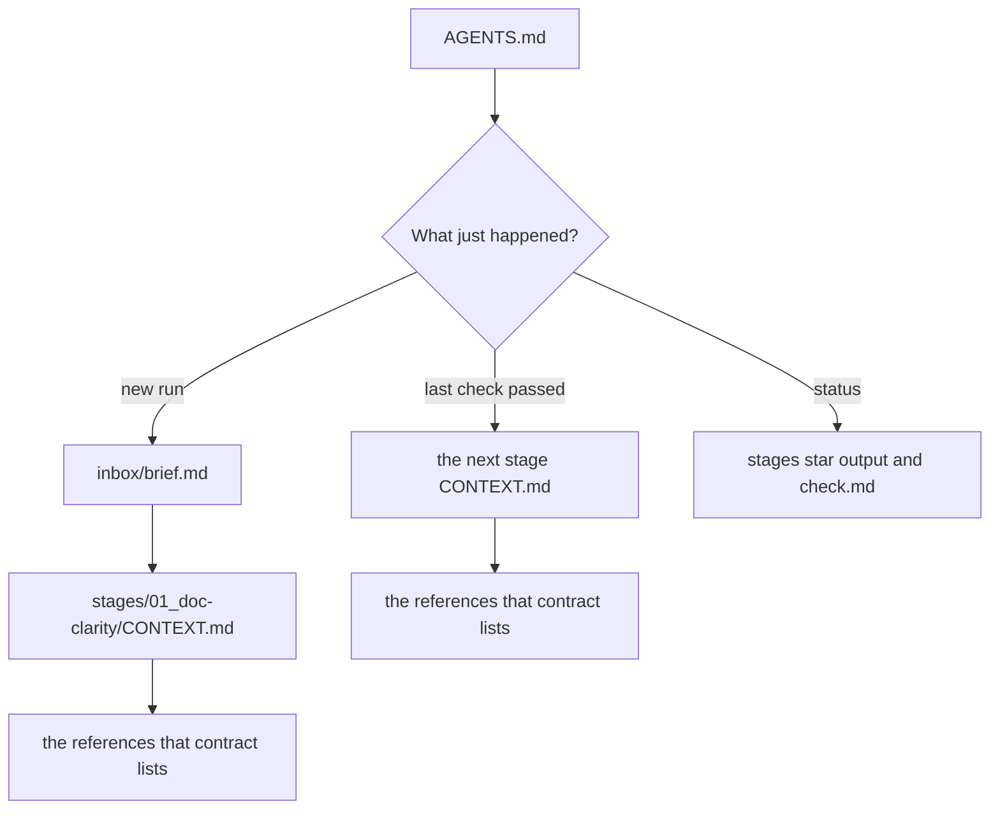
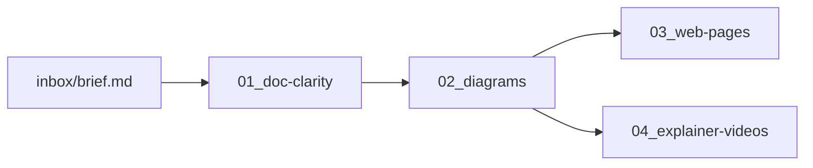
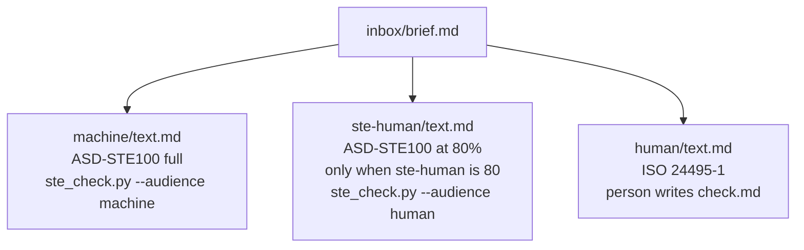
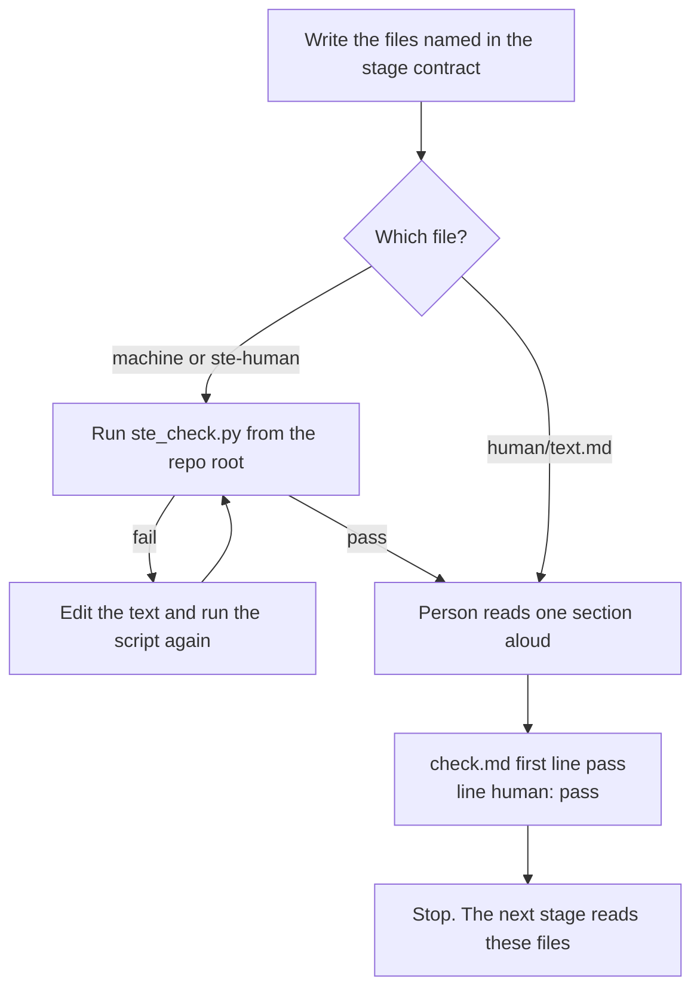

# Agent manual - run one stage and stop

One job: follow the route in [AGENTS.md](../AGENTS.md), write that stage's files, and stop at its check.

During a run, the stage `CONTEXT.md` is the contract. This file is the map. Stage jobs are listed in [CONTEXT.md](../CONTEXT.md).

## What to load

Load the stage contract the route names. Then load only the references that contract lists.



## The climb

Write stage 01 before any later stage. Stop at the rung in `climb-to`. Skip `03_web-pages` when the brief asks for a video and not a page. The video stage reads the writing and a passed diagram. It does not read the HTML page.



## The three writing files

Read `audiences` and `ste-human` from the brief. A missing field uses `_shared/defaults.md`. The default is `audiences: both` and `ste-human: no`.



The 80% target applies to `ste-human/text.md` only. `human/text.md` follows `references/plain-language.md`.

Same claims in every file you write. Same order of conditions. A warmer sentence may not add a fact.

## Checks

A stage is complete when each required `check.md` starts with `pass` and contains the line `human: pass`. A `.gitkeep` is not a complete stage.



Commands, from the repo root, and only for a file you wrote:

```bash
python _tools/ste_check.py stages/01_doc-clarity/output/{slug}/machine/text.md --audience machine
python _tools/ste_check.py stages/01_doc-clarity/output/{slug}/ste-human/text.md --audience human
python -I _tools/links.py
```

Run the link check after you add or rename a markdown path.

## Later stages

Read `stages/01_doc-clarity/output/current.md`, then the manifest it names. Ignore a path value of `none`.

Use `human/text.md` when the manifest lists it. Use `ste-human/text.md` only when `human` is `none`. Use the machine file only when both of those are `none`. Load one writing file.

Require a passing `check.md` for every writing file the manifest lists, and for `figures.md` when that file exists.

## License

The repo license is MIT: [LICENSE.md](../LICENSE.md). ASD-STE100 and ISO 24495-1 stay with their owners. The summaries and the tool attribution are in the License section of [README.md](../README.md).
